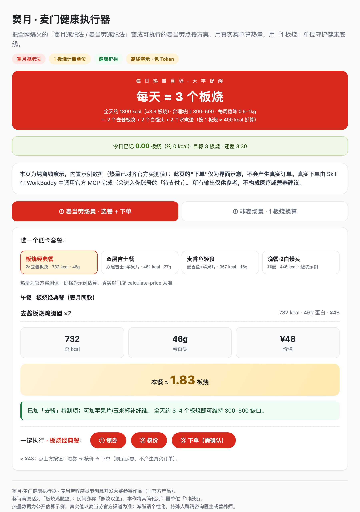
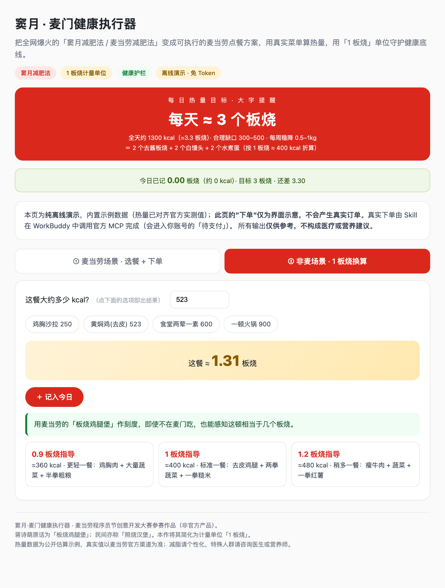
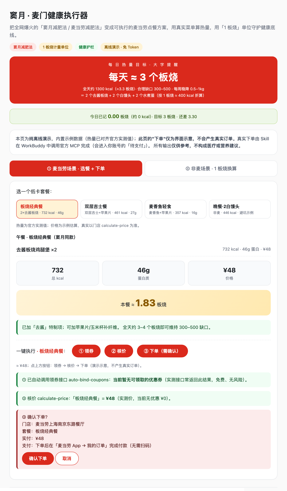
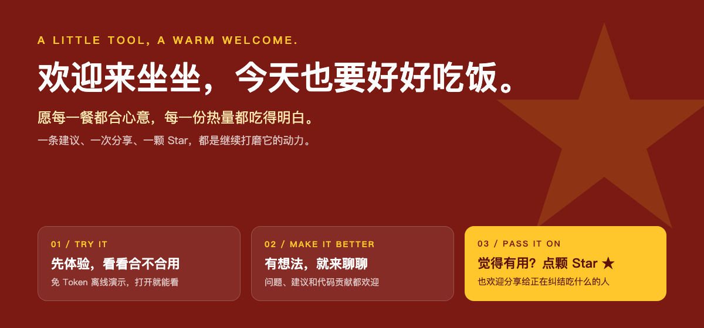

# 窦月·麦门健康执行器 · douyue-mcd-coach

[](https://github.com/Xianmuyingyue/douyue-mcd-coach)　**⭐ 觉得有意思就点个 Star 支持参赛（本次比赛按 GitHub Star 排名）**　[🎮 免 Token 演示](docs/index.html)

> 蒋诗萌综艺带火的「窦月减肥法 / 麦当劳减肥法」冲上热搜后，全网都在问：到底怎么吃？
> 本项目把它做成一个**能真正执行**的麦当劳 Skill：一键生成低卡套餐、用「1 板烧」看懂热量、用官方真实菜单核价、直接下单并在**麦当劳 App 里安全付款**——同时用医生改良版守住健康底线。

⚠️ 本项目为麦当劳程序员节创意开发大赛参赛作品，**非麦当劳官方产品**；输出**仅供参考，不构成医疗或营养建议**。

## 🔥 为什么做这个：明星效应引爆的"麦门减肥"

2026-10-13 前后，蒋诗萌在综艺里分享的吃法——**早餐黑咖 + 水煮蛋、午餐两个去酱汉堡、晚餐白馒头、8 小时进食窗口**（网友称"窦月减肥法""汉堡馒头减肥法"）冲上热搜，全网跟风。

但它有两个坑：**① 照抄容易走极端、伤身体；② 没人告诉你在麦当劳到底点哪几个、花多少钱、缺口多少。** 本项目就补这两个坑——把"明星同款"变成**可执行、可核价、还能安全付款**的低卡麦当劳方案。

## ✨ 三大核心亮点

### 1️⃣ 减肥功能：不只是算热量，是"能执行的减脂方案"
- **结构化执行**：按窦月法早 / 中 / 晚自动生成麦当劳方案，算清全天热量、蛋白质、缺口。
- **健康护栏（差异化）**：全天 < 基础代谢下限、或晚餐只吃白馒头缺蛋白时，**强制**触发医生改良版（去酱 + 蔬菜 + 粗粮 + 优质蛋白，缺口 300–500，每周 0.5–1kg）。
- **一周执行日历**：7 天打卡，计划 vs 实际、累计缺口、风险标记。
- **真实数据**：热量来自官方 `list-nutrition-foods`（实测板烧鸡腿堡 **391 kcal / 23g 蛋白**），价格来自 `calculate-price`（实测 2×板烧 = **¥48**），不靠模型瞎猜。
- **每日累计与记录**：每餐按「板烧」记入当日累计（持久化到 `~/.workbuddy/douyue_mcd_coach/daily.json`，**非麦场景也能一键记入**）；附**可选、默认关闭**的每日中午/晚上提醒自动化（见 `docs/automation.md`）。

### 2️⃣ 明星效应：绑定爆款话题，自带传播势能
- 直接锚定"窦月减肥法 / 蒋诗萌 / 麦门减肥"这一**具体爆款**，而非通用"卡路里查询"红海。
- 保留明星原话「板烧鸡腿堡」，让用户一眼认出"就是那个吃法"。

### 3️⃣ 低卡套餐简单可选：几键搞定，看得懂、选得快
- **3 款低卡套餐一键切换**：板烧经典餐（2×去酱板烧 732 kcal）、双层吉士餐（双层吉士 + 苹果片 461 kcal）、麦香鱼轻食（麦香鱼 + 苹果片 357 kcal）——再加 1 个"白馒头避坑"对比，热量均为官方实测值。
- **「1 板烧」单位**：把任何一餐换算成"几个板烧"，并给 0.9 / 1.0 / 1.2 三档等热量替代餐，非麦场景也能选。
- 离线演示页两屏直达：① 麦当劳场景（选餐 + 下方内嵌领券 / 核价 / 下单）→ ② 非麦换算。

## 🖼️ 详细演示



*① 麦当劳场景：3 款低卡套餐任选（板烧 / 双层吉士 / 麦香鱼），选中即出热量 · 蛋白 · 价格 · 板烧。*



*② 非麦场景：任意热量 → "这餐 ≈ X 板烧" + 0.9 / 1.0 / 1.2 三档等热量替代餐。*



*② 场景一·一键执行：选中套餐后，下方直接领券 → 核价 → 确认下单（待支付）→ 在麦当劳 App「我的订单」安全付款。*

> 以上为免 Token 离线演示页 `docs/index.html` 的**真实截图**（示例数据已对齐官方实测值）。

## 🚀 真实能力（已实测，2026-10-18）

| 能力 | 工具 | 实测结果 |
|---|---|---|
| 真实营养 | `list-nutrition-foods` | 160 条餐品；板烧鸡腿堡 391 kcal / 23g 蛋白 |
| 找店 / 菜单 | `query-nearby-stores` / `query-meals` | 上海某门店（已脱敏），106 个餐品 |
| 核价 | `calculate-price` | 2×板烧 = **¥48**（优惠 ¥0） |
| 领券 | `auto-bind-coupons` | 接口通；当前暂无可领券（code 499） |
| 下单 | `create-order` | 真实生成「待支付」订单，**不扣款** |
| 支付路径 | — | **已实测：订单出现在麦当劳 App「我的订单」，可直接付款**（尾号 249953 / 20:01:23） |

> **支付方式**：首选「打开麦当劳 App → 我的订单 → 待支付 → 直接付款」（无需扫码，最安全）；电脑端可打开 `payH5Url` 出二维码给手机 App 扫；**不要在手机上直接打开 `payH5Url`**（实测会显示扫不了的二维码）。

## 🎯 目标用户

- 想跟风"窦月减肥法"又担心不健康、需要科学护栏的普通人；
- 减脂期戒不掉麦门的健身 / 上班族；
- 想"吃得心里有数"、又懒得每顿查热量表的人。

## 🚀 安装与配置

### 1. 申请麦当劳 MCP Token
1. 打开 [open.mcd.cn/mcp](https://open.mcd.cn/mcp)，用手机号登录；
2. 点右上角【控制台】→【激活】→ 申请 MCP Token；
3. 复制 Token（**只存本地，切勿写入文件或公开**）。

### 2. 在 WorkBuddy 里配置 MCP 连接器
1. 左侧边栏【专家·技能·连接器】→ 选中【连接器】页签；
2. 右上角【自定义连接器】→【配置 MCP】；
3. 粘贴下面 JSON，把 `YOUR_MCP_TOKEN` 换成你的 Token：

```json
{
  "mcpServers": {
    "mcd-mcp": {
      "type": "streamablehttp",
      "url": "https://mcp.mcd.cn",
      "headers": {
        "Authorization": "Bearer YOUR_MCP_TOKEN"
      }
    }
  }
}
```

4. 点【保存】→ 回到【自定义连接器】，把 `mcd-mcp`【启用】。

### 3. 安装本 Skill（三选一）
- **A · 从 SkillHub 安装**：WorkBuddy 左侧【技能】→ 搜索「窦月·麦门健康执行器」→ 安装 / 启用。
- **B · 本地安装（推荐）**：
  ```bash
  git clone https://github.com/Xianmuyingyue/douyue-mcd-coach
  cd douyue-mcd-coach
  python install.py --target workbuddy   # 复制到 ~/.workbuddy/skills/douyue-mcd-coach
  ```
- **C · 手动放置**：把整个 `douyue-mcd-coach` 文件夹拷到 `~/.workbuddy/skills/` 下。

## 💬 怎么调用（直接用自然语言）

| 你想做什么 | 直接说 |
|---|---|
| 安排一餐 | 「我想吃麦当劳，帮我安排一顿低卡午餐」 |
| 换算板烧 | 「食堂黄焖鸡 523 大卡，算几个板烧？」 |
| 看券 / 核价 | 「今天有什么券？两个去酱板烧多少钱」 |
| 下单 | 「帮我下单，去酱板烧×2，到店自取」 |
| 付款 | 「下单后去麦当劳 App → 我的订单 → 付款」 |
| 记录 | 「把这顿记入今日」 |

### 完整订餐流程（对话示例）

```
你：我想吃麦当劳，帮我安排低卡午餐，然后下单
教练：按窦月法午餐推荐「板烧经典餐」——2×去酱板烧，约 732 kcal / 46g 蛋白 / ¥48，≈1.83 板烧。
      全天约 3–4 个板烧即可维持 300–500 缺口。确认这个套餐吗？
你：确认
教练：（领券 → 核价）当前暂无可领券；门店：麦当劳上海南京东路餐厅；清单：去酱板烧×2；实付 ¥48。
      确认下单吗？
你：确认
教练：订单已创建（待支付）。请打开麦当劳 App →「我的订单」→ 付款即可（无需扫码）。
你：付好了
教练：（query-order 核对）已支付，取餐码 XXXX。本餐 ≈ 1.83 板烧。
```

> 关键安全点：**下单前一定先给你看门店 / 清单 / 金额，二次确认后才提交；下单不扣款，付款在麦当劳 App 完成。**

### 常见问题

| 现象 | 原因 / 处理 |
|---|---|
| 连接器报 401 / Token 无效 | 没替换 `YOUR_MCP_TOKEN`，或 Token 前后有空格 |
| `600039 今日下单数已达上限` | 账号级**每日下单次数**用尽，与餐品无关；明天再试，别换单硬刷 |
| 领券返回 `499` / 无券 | 正常（当前无可领券），直接按原价核价 |
| 手机打开支付链接只看到二维码 | 那是「扫码中间页」，同机扫不了自己屏幕；**去麦当劳 App「我的订单」直接付款** |
| 查不到门店 / 菜单 | 确认 `mcd-mcp` 已启用、Token 有效、网络正常 |

## 🎮 免 Token 离线演示

不想配 Token？直接打开 [`docs/index.html`](docs/index.html) 即可——**无需 Token、无需联网、零依赖**（双击或拖进浏览器），两屏：① 麦当劳场景（选低卡套餐 + 下方内嵌领券 / 核价 / 下单）、② 非麦场景 1 板烧换算。

## 📁 目录结构

```
douyue-mcd-coach/
├── README.md                  本文件
├── SUBMISSION.md              提交说明 / 校验清单 / 报名 Issue 文案
├── CONTEST_DECLARATION.md     参赛声明（官方原文，一字未改）
├── MCP_INTEGRATION.md         MCP 接入、调用流程、支付交付策略
├── mcp-config.example.json    脱敏 MCP 配置示例（仅占位符）
├── SKILL.md                   智能体主流程
├── workbuddy.md               WorkBuddy 联动开发记录
├── install.py                 一键安装脚本
├── docs/
│   ├── index.html             免 Token 离线演示页（单文件，零依赖）
│   ├── automation.md          可选自动化（每日中午/晚上提醒，默认关闭）
│   └── images/                演示截图（README 引用）
├── references/
│   ├── douyue_method.md       窦月减肥法结构化定义与热量估算
│   ├── health.md              健康护栏（医生改良版与免责边界）
│   ├── unit.md                1 板烧计量单位与三档替代餐指导
│   └── competition_landscape.md  竞争态势分析（官方榜单 + 蓝海定位）
└── scripts/
    ├── plan_draft.py          离线草案（示例数据，零依赖）
    ├── mcp_client.py          官方 MCP 客户端（TOON 解析 + 领券/核价/下单）
    ├── live_plan.py           用真实 MCP 营养数据生成窦月法方案
    └── daily_tracker.py       每日卡路里/板烧累计（持久化到 ~/.workbuddy/）
```

## 🧭 项目入口

| 文件 | 用途 |
|---|---|
| [`docs/index.html`](docs/index.html) | 免 Token 离线演示，打开就能看 |
| [`SKILL.md`](SKILL.md) | 智能体主流程与健康护栏 |
| [`scripts/live_plan.py`](scripts/live_plan.py) | 用真实 MCP 营养数据生成方案 |
| [`scripts/mcp_client.py`](scripts/mcp_client.py) | 官方 MCP 客户端（领券 / 核价 / 下单） |
| [`scripts/daily_tracker.py`](scripts/daily_tracker.py) | 每日板烧累计（本机持久化） |
| [`references/health.md`](references/health.md) | 健康护栏（医生改良版与免责边界） |
| [`MCP_INTEGRATION.md`](MCP_INTEGRATION.md) | MCP 接入、调用流程与支付策略 |

## 💛 欢迎与支持



如果这个项目帮你"既能吃麦门、又不走极端"，欢迎点个 ⭐ Star 支持；也欢迎把问题、建议留在 Issue 区。

## 🏆 参赛信息

- 赛事：2026 麦当劳程序员创意开发大赛（1024 程序员节）
- 开发工具：腾讯 WorkBuddy（辅助开发）
- 免 Token 即可体验：`docs/index.html`；真实能力与实测证据见 `MCP_INTEGRATION.md`
